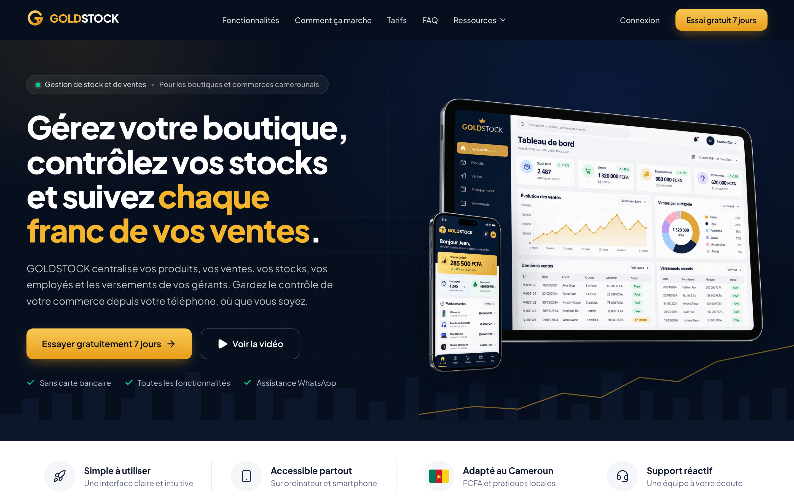
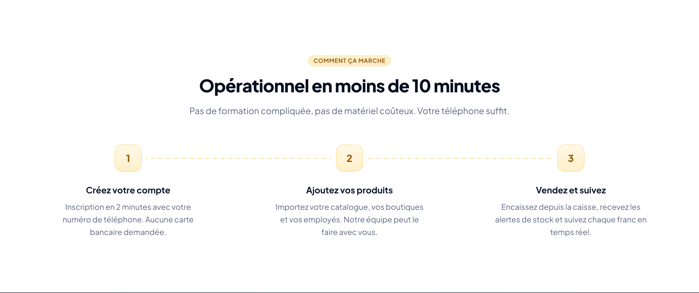
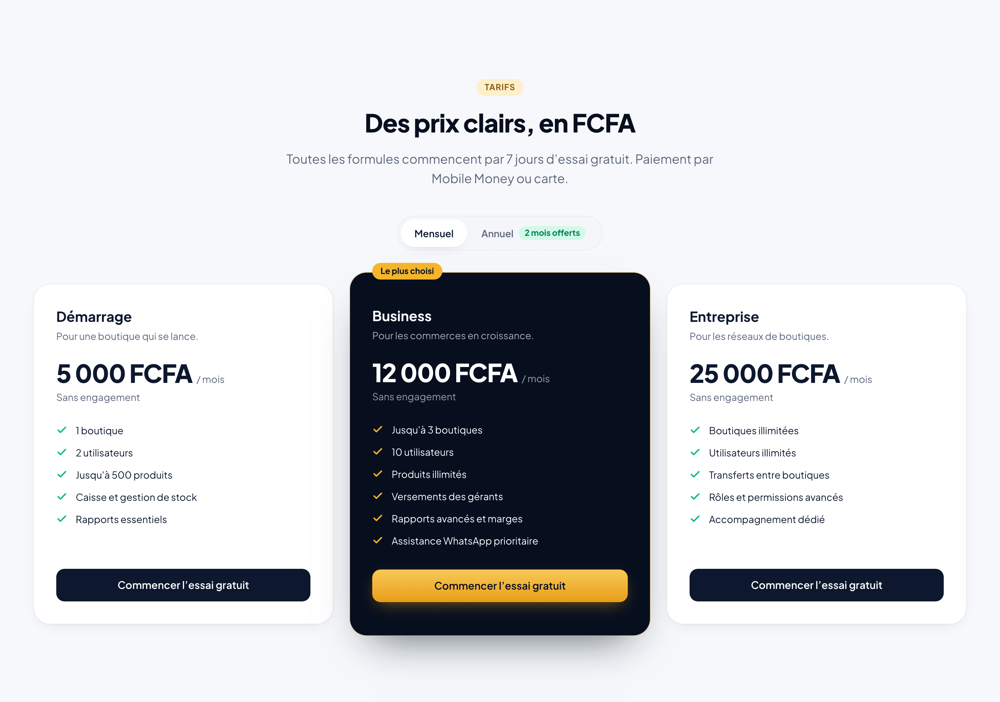
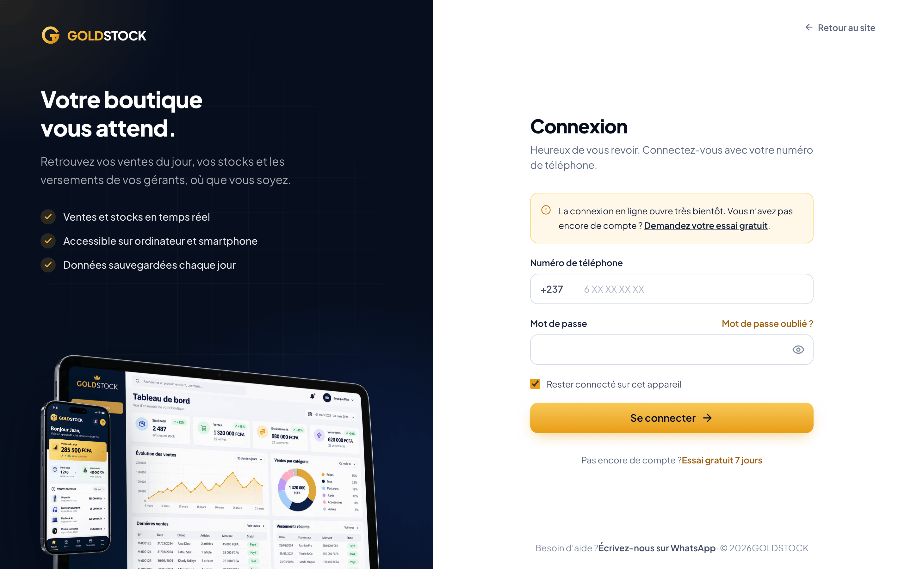
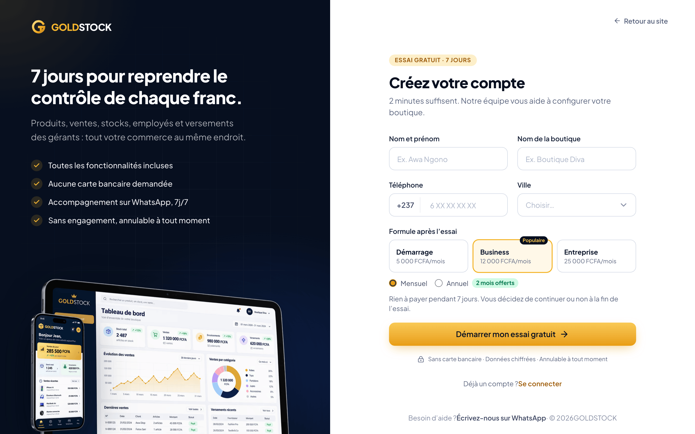
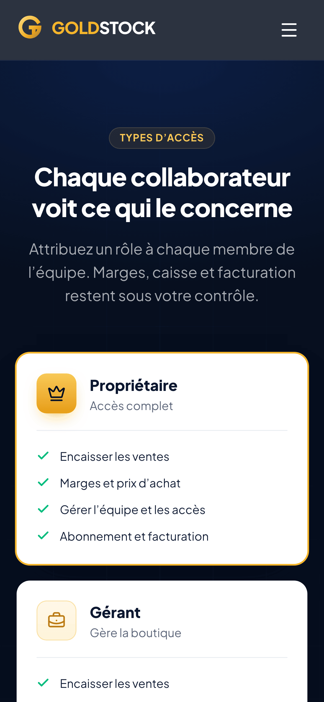
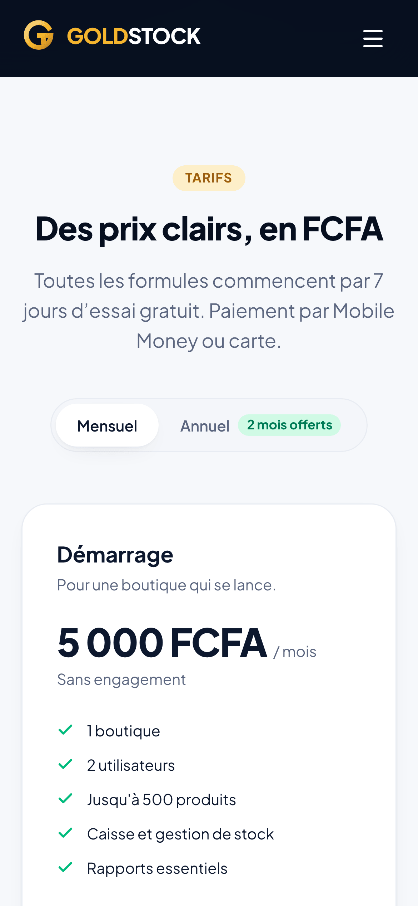
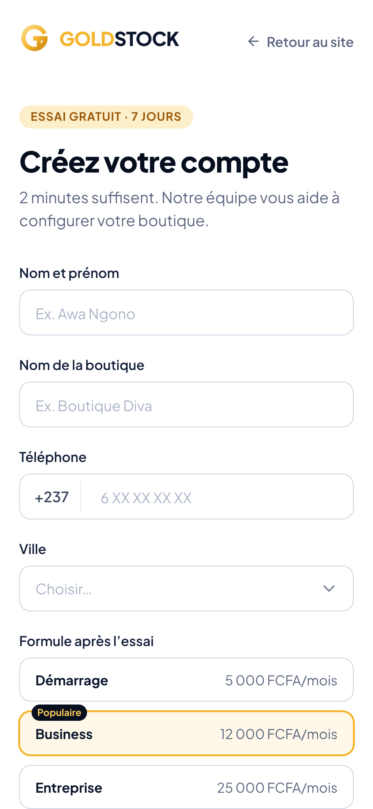

<div align="center">


# GOLDSTOCK

**Landing page d'un logiciel de gestion de stock et de ventes pensé pour les boutiques et commerces camerounais.**

[**Voir le site en ligne →**](https://goldstock-psi.vercel.app)


</div>

---

## Le projet

GOLDSTOCK aide les commerçants à suivre leurs produits, leurs ventes, leurs stocks, leurs employés et les versements de leurs gérants, depuis un ordinateur ou un téléphone. Cette landing page présente le produit, ses formules en FCFA et ouvre l'essai gratuit de 7 jours.

**Points forts**

- **Identité navy et or** déclinée sur toute la page : tokens Tailwind dédiés, mockups tablette et iPhone en relief, halos et grille en arrière-plan.
- **Animations au défilement** douces et décalées, désactivées automatiquement pour les utilisateurs qui préfèrent réduire les animations.
- **Rapide par conception** : HTML statique, seuls les éléments interactifs (menu, tarifs, formulaires) chargent du JavaScript ; images servies en AVIF et WebP.
- **Pensé pour le Cameroun** : prix en FCFA, numéros au format +237, paiement Mobile Money, relais WhatsApp.
- **Accessible** : navigation au clavier, lien d'évitement, libellés pour lecteurs d'écran.
- **Déploiement continu** : chaque push sur `main` met le site à jour sur Vercel.

---

## Aperçu

### Accueil



### Fonctionnalités


### Comment ça marche



### Types d'accès


### Tarifs



### Connexion et essai gratuit

<table>
  <tr>
    <td width="50%"></td>
    <td width="50%"></td>
  </tr>
  <tr>
    <td align="center"><sub>Connexion par numéro de téléphone</sub></td>
    <td align="center"><sub>Essai gratuit de 7 jours, formule pré-sélectionnée</sub></td>
  </tr>
</table>

### Sur mobile

<table>
  <tr>
    <td width="25%"></td>
    <td width="25%"></td>
    <td width="25%"></td>
    <td width="25%"></td>
  </tr>
  <tr>
    <td align="center"><sub>Accueil</sub></td>
    <td align="center"><sub>Types d'accès</sub></td>
    <td align="center"><sub>Tarifs</sub></td>
    <td align="center"><sub>Essai gratuit</sub></td>
  </tr>
</table>

---

## Stack technique

| Domaine     | Choix                                                             |
| :---------- | :---------------------------------------------------------------- |
| Framework   | Astro 7 (site statique) avec îles React 19                        |
| Style       | Tailwind CSS 4 (`@theme` navy et or), Plus Jakarta Sans           |
| Langage     | TypeScript strict                                                 |
| Images      | `astro:assets` (`<Picture>` en AVIF et WebP, tailles responsives) |
| Icônes      | lucide-react                                                      |
| Qualité     | `astro check`, Prettier                                           |
| Hébergement | Vercel, déploiement automatique depuis GitHub                     |

## Commandes

| Commande          | Action                                         |
| :---------------- | :--------------------------------------------- |
| `npm install`     | Installe les dépendances                       |
| `npm run dev`     | Serveur de développement sur `localhost:4321`  |
| `npm run check`   | Vérification TypeScript / Astro                |
| `npm run build`   | Vérifie puis génère le site statique (`dist/`) |
| `npm run preview` | Prévisualise le build                          |
| `npm run format`  | Formate le code avec Prettier                  |

## Structure

```text
src/
├── data/site.ts            # Contenu, liens, tarifs, rôles, FAQ (point d'édition unique)
├── lib/auth.ts             # Appels API connexion / inscription, validation des numéros +237
├── layouts/
│   ├── Layout.astro        # <head> SEO, Open Graph, JSON-LD, lien d'évitement
│   └── AuthLayout.astro    # Mise en page connexion / essai gratuit
├── pages/
│   ├── index.astro         # Page d'accueil
│   ├── connexion.astro     # /connexion
│   └── essai-gratuit.astro # /essai-gratuit (accepte ?formule=…&facturation=…)
├── styles/global.css       # Tokens Tailwind (@theme), utilitaires, animations au défilement
└── components/
    ├── Header.tsx          # Île React : menu Ressources + menu mobile
    ├── VideoDialog.tsx     # Île React : <dialog> natif pour la démo vidéo
    ├── Pricing.tsx         # Île React : bascule mensuel / annuel
    ├── auth/               # Îles React : formulaires de connexion et d'essai gratuit
    ├── brand/              # Logo, drapeau, icône WhatsApp
    └── sections/           # Sections statiques de la page
docs/screenshots/           # Captures utilisées dans ce README
```

## Connexion et essai gratuit

Les formulaires appellent l'API définie par `PUBLIC_API_URL` (voir `.env.example`) :

- `POST /auth/login` — `{ phone, password, remember }` ; `401` = identifiants incorrects.
- `POST /auth/signup` — `{ fullName, shopName, phone, city, password, plan, billing }` ; `409` = numéro déjà utilisé.

Le numéro est envoyé au format `+2376XXXXXXXX`, la session passe par cookie (`credentials: 'include'`), et la réponse peut fournir `redirectUrl` (sinon redirection vers `appUrl`).

Tant que `PUBLIC_API_URL` n'est pas défini, l'essai gratuit masque le mot de passe et prépare la demande sur WhatsApp (nom, boutique, ville, téléphone, formule), et la page de connexion indique que l'accès en ligne ouvre bientôt.

Seuls les composants interactifs sont hydratés (`client:load`, `client:idle`, `client:visible`) ; tout le reste est rendu en HTML statique.

## Déploiement

Le dépôt est relié à Vercel : chaque push sur `main` déclenche un déploiement de production, et chaque autre branche reçoit une URL de prévisualisation. Les variables d'environnement (`PUBLIC_API_URL`) se règlent dans Vercel, sous Settings → Environment Variables.

## À configurer avant le lancement

Dans Vercel (ou `.env` en local) : `PUBLIC_API_URL`. Dans `src/data/site.ts` : `appUrl`, `whatsappNumber`, `email`, `demoVideoUrl` (vide = message d'attente avec lien WhatsApp), et les prix des formules. Dans `astro.config.mjs` : `site` (utilisé pour l'URL canonique).
